<p align="center"></p>

# The Wake

> *A world folder was sent to us with one note: "I never wrote this."*

**The Wake** is a slow horror mod for **Minecraft Java 1.21.1**, for **NeoForge** and **Fabric**.
It works through things you already do without thinking about them: sleeping, pausing, opening
your inventory. Most of the time there is nothing to see.

Something in your world only moves while you are not watching it. Stay up to keep it out of your
nights, and it resents you for it. Make it angry enough, and frighten yourself enough, and one night
it stops waiting.

---

## Install

| | NeoForge | Fabric |
|---|---|---|
| Minecraft | 1.21.1 | 1.21.1 |
| Loader | NeoForge 21.1.265 or newer | Fabric Loader 0.16.14 or newer + **Fabric API** |
| Java | 21 | 21 |

Drop the jar for your loader into `mods/`. The haunting needs it **on both the client and the
server**. A client with the mod can still join servers without it (nothing happens there), and
the other way round.

How to play it: start (or keep playing) an ordinary survival world and live in it the way you
normally would. It takes a few in-game days to begin. Singleplayer is the intended experience.
Headphones help.

## Content notes

- **Jump scares.** From the fourth act: a face filling the screen, a slow blink, a jaw that keeps
  opening, a picture tear and a short distorted scream. This only happens if you stay in a menu with
  it at arm's length, never in your sleep or through the pause screen, and not again for a few
  minutes after.
- **Chases.** When it is angry, it may chase you, with **very loud screams** and a heartbeat under
  them. If it catches you, it holds you up to its face. Screams have their own volume setting
  (`screamVolume`), chases can be turned off (`chases`), and the tape tear can be turned off with
  everything else visual (`tapeEffect`).
- A tall, flat-black stick figure like a stop-motion puppet, with pale long-fingered hands sewn on
  at the wrists. Its head is an old index card cut to the shape of a face that is too long, a real
  face pressed into it from behind, wet eyes looking through holes torn in it, its chin a
  ventriloquist's dummy's held on with stitches. Some blood, bloodshot eyes, teeth. No gore.
- The picture is made to look like worn videotape at times: grain, scanlines, rolling tracking
  noise. No strobing.
- It can damage you (default six hearts, through armour). In hardcore it leaves you at half a
  heart instead of killing you.
- It can move you, change the time of day in singleplayer, make you hungrier, stop you sleeping,
  and open and close doors. In a chase it breaks through walls to reach you and tears iron doors
  out and throws them. Everything it breaks **drops as an item**, so nothing is ever lost. Both
  have switches and a per-chase limit. Optional world edits (`worldEdits`):
  - a placed torch;
  - ripened crops;
  - closed doors;
  - furnace output moved into your chest;
  - a few times in a whole haunting, a new name on the thing in your hand.
- In a world first started in survival, switching to creative or spectator does not save you: it
  opens your chat box and types `/gamemode survival` into it, one key at a time (`possession`).
- Everything "meta" stays inside the game: no files outside the game folder, no fake crashes, no
  window-title tricks. It notices real lag spikes but never fakes one.

## Config

`config/thewake.json` is created on first launch. Every option is explained inside the file.

| Option | Default | What it does |
|---|---|---|
| `pace` | `1.0` | Speed of the whole arc. `2.0` is twice as fast. |
| `quietNights` | `1` | Nights you can sleep through before anything happens. |
| `menuHunts` | `true` | It moves while you are in a menu (inventory, chests, crafting, chat), within 48 blocks of your bed. |
| `pauseEvents` | `true` | The pause menu counts too, while the game window has focus. Alt-tabbing never does. |
| `afkEvents`, `afkSeconds` | `true`, `150` | Standing idle is a lapse. |
| `hitchEvents` | `true` | Real frame stalls over one second count (capped per day). |
| `attacks` | `true` | From Act IV it bites if you stay in a menu with it at arm's length. |
| `attackDamage` | `12.0` | In half-hearts. Armour does not help. |
| `attackHardcoreKills` | `false` | Hardcore: off leaves you at half a heart. |
| `blinkEvents` | `true` | Late game: short blackouts in daylight. Never in hardcore. |
| `stolenMornings` | `true` | Late game: sometimes you do not wake where you went to sleep. Never in hardcore. |
| `worldEdits` | `true` | The small Act I chores near your bed, and the door it leaves open. |
| `finale` | `true` | The finale. |
| `finaleOnServers` | `false` | Allow the finale on multiplayer servers (see below). |
| `tapeEffect` | `true` | Client: the VHS look. |
| `nightSkyShader` | `true` | Client: the finale's ground shader. Turned off automatically while an Iris/Oculus shader pack is active. |
| `soundVolume` | `1.0` | Client: volume of this mod's own sounds. |
| `screamVolume` | `0.8` | Client: volume of the one loud sound. |
| `dimensions` | `["minecraft:overworld"]` | Where it can reach you (its own places always count). |
| `angerRate` | `1.0` | How fast it gets angry with you. `0` keeps it calm forever. |
| `chases` | `true` | When it is angry and you are afraid enough, it comes after you for real. Off: it only ever watches. |
| `chaseBreaksBlocks`, `chaseBreakLimit` | `true`, `48` | It breaks through walls, pillars and boxes in a chase (blocks drop). |
| `chaseRipsDoors` | `true` | It tears iron doors and trapdoors out and throws them (they drop where they land). |
| `chaseDamage` | `10.0` | Damage when it catches you in a chase, in half-hearts. |
| `possession` | `true` | Creative or spectator mode does not save you: it types `/gamemode survival` into your chat. Never in worlds started in creative. |
| `torment` | `true` | Things with nothing to see: knocking, breathing behind walls, steps behind you, doors, scraping in caves. |

## Commands

All need permission level 2 (cheats on in singleplayer):

- `/thewake status [player]`: how far along a player is.
- `/thewake stage <player> <stage>`: jump to an act (`night_shift`, `watching`, `sightings`,
  `routine`, `hunt`, `hush`, `stopped`).
- `/thewake beat <player> <beat>`: play one beat right now (`sighting`, `giant`, `morning`,
  `hunt`, `attack`, `headturn`, `ledger`, `stopped`, …). Meant for testing; it spoils things.
- `/thewake reset <player>`
- `/thewake anger <player> <0-1>`, `/thewake tension <player> <0-1>`: set its temper, or how afraid
  the director thinks you are.
- `/thewake body <player> <chase|stalk|lurk|siege|asleep|last_night>`: put its body out, now.
- `/thewake go <player> <archive|set|home>`, `/thewake pins <player> <n>`, `/thewake kit <player>`
  (camera, bulbs, tape, recorder), `/thewake possess <player>`.

## Multiplayer

Each player has their own haunting, and nobody else can see it. Its images are not entities at all,
and its body (in a chase) is sent to its owner's client only. On a server
the pause menu does not stop the world, so it counts like any other menu. The finale is off by
default on servers, because it freezes the world for one player while the server keeps running
for everyone else; turn on `finaleOnServers` to allow it.

## Compatibility

- **Shader packs (Iris/Oculus):** the creature is drawn with vanilla's entity shader, so packs
  treat it like any entity. The finale's ground switches to a texture while a pack is active.
- **Sleep mods** that speed nights up instead of skipping them still count.
- **Other horror mods** work alongside it. Its body is never spawned naturally, so it does not
  collide with their spawns.
- **Peaceful** does not send it away.

## Building from source

```bash
./gradlew build
```

The jars end up in `fabric/build/libs/` and `neoforge/build/libs/`. Run a test client with
`./gradlew :fabric:runClient` or `./gradlew :neoforge:runClient`.

A scripted visual demo stages every beat in order and saves screenshots to
`<loader>/runs/client/screenshots`. It needs a singleplayer world called `demo` in that run
folder:

```bash
./gradlew :fabric:runClient -PwakeDemo
```

A second demo stages the expansion (its faces, a chase, a door torn out, a pillar, the water, the
watchtower, the flash, the chat box, its places):

```bash
./gradlew :fabric:runClient -PwakeDemo2
```

The creature was designed as pixel art first (`tools/concepts/`, sheets in
[`docs/concepts/`](docs/concepts/)) and is built procedurally in headless Blender, with no GUI and
no MCP server: Blender as a Python module. Its head is drawn by `tools/creature/card.py` from the
same numbers as the pixel art; its skeleton, poses and stop-motion clips are in
`tools/creature/poses.py`.

```bash
pip install bpy==5.2.3 numpy pillow
```

```bash
python tools/creature/build_creature.py --previews
```

That writes the model (`models/creature/creature.bin.gz`: a skeleton, skin weights, rigid parts and
baked clips, format in `tools/creature/export_v3.py`), its two textures and Cycles preview renders.
The game skins it on the CPU with dual quaternions, the same as Blender, checked on every build. Its
four faces (one for each temper) are painted from the same card by `card.dress`. The mod's own
sounds and small textures are synthesized by `tools/generate_assets.py` (numpy, Pillow, ffmpeg with
libvorbis); the block and item textures by `tools/textures/draw_textures.py`. The chase and torment
sounds are recordings from sound libraries (CC0, CC-BY and public domain): see
[`CREDITS.md`](CREDITS.md).

<details>
<summary><b>Screenshots (spoilers)</b></summary>


*The model, rendered in Blender by `tools/creature/build_creature.py`.*

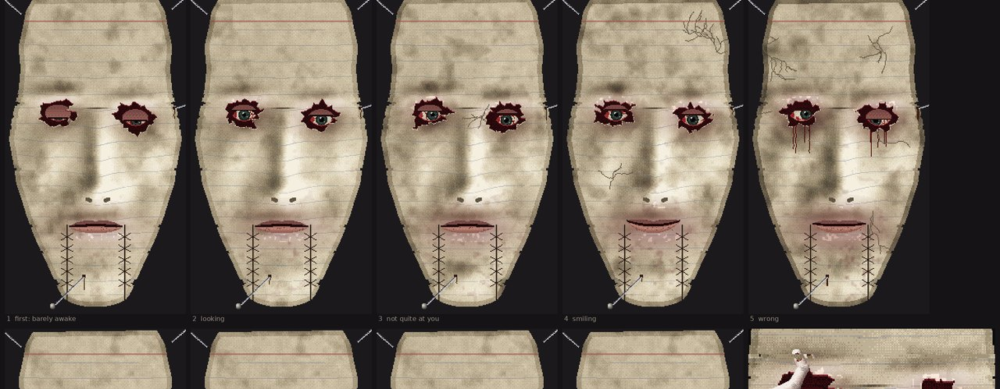

*It was designed as pixel art first. These are its replacement faces, like a stop-motion puppet's; the other sheets are in [`docs/concepts/`](docs/concepts/).*

Captured in game by the scripted demo:

| | |
|---|---|
|  | 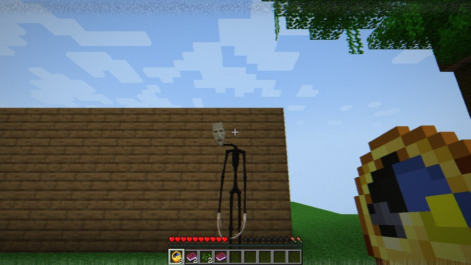 |
| *At the edge of your view. Look straight at it and it is still.* | *Look away and back, and it is facing you.* |
|  |  |
| *While you sort your inventory, it walks in, a few drawings a second.* | *The pause menu is a paused tape. It is still coming.* |
|  | 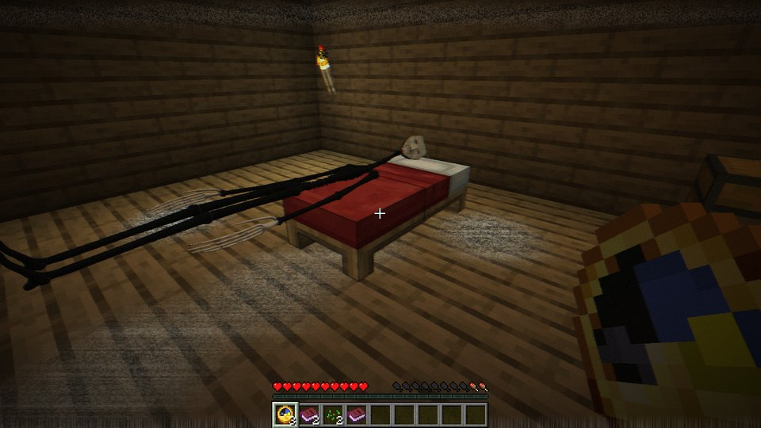 |
| *If you stay in the menu with it at arm's length.* | *The finale. It is in your bed.* |

Its temper, its body and its places (the expansion's demo, `-PwakeDemo2`):

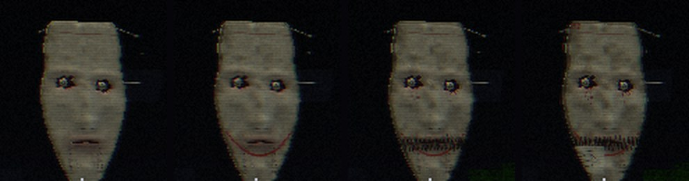

*Watcher, uneasy, angry, furious.*

| | |
|---|---|
| 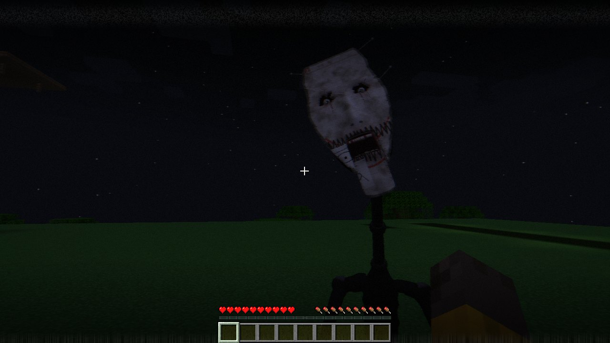 | 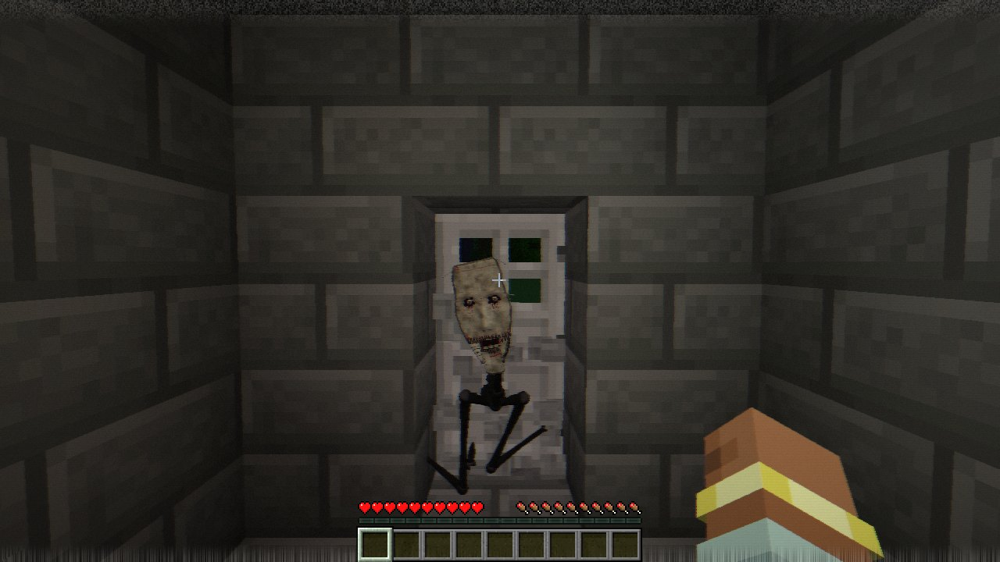 |
| *Caught. Struggle (sneak, over and over) before the jaw goes.* | *The iron door is lying in the grass behind it.* |
| 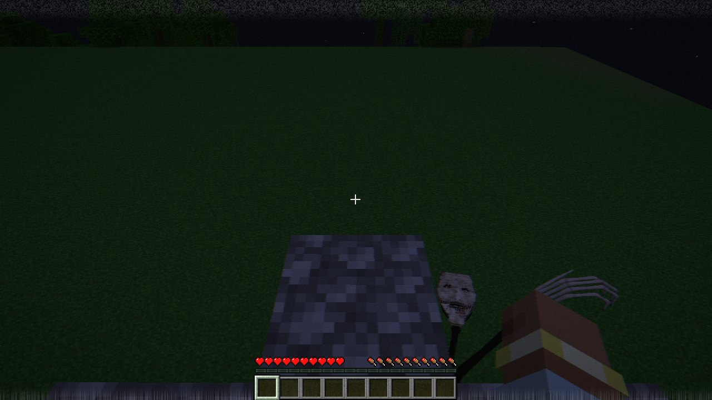 | 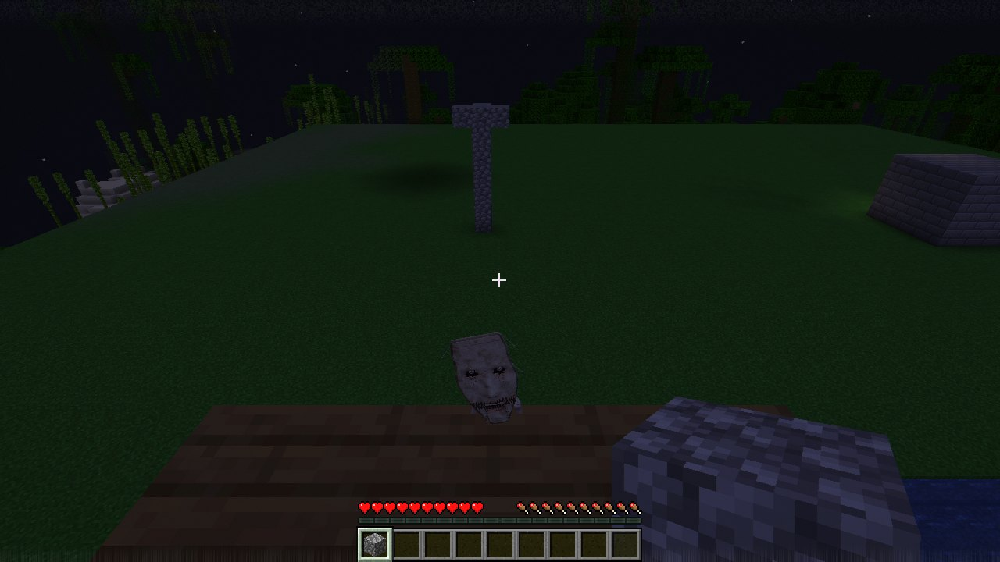 |
| *A pillar with a lip round it. It climbs, breaks the lip, and has you.* | *Your watchtower. It came up the other side.* |
| 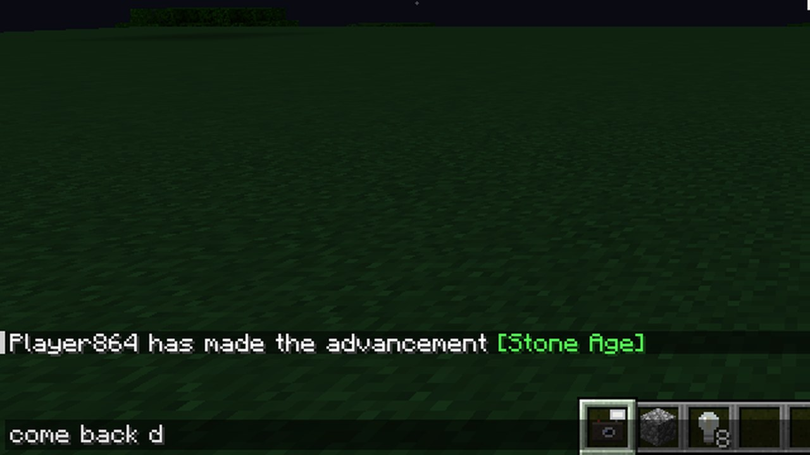 | 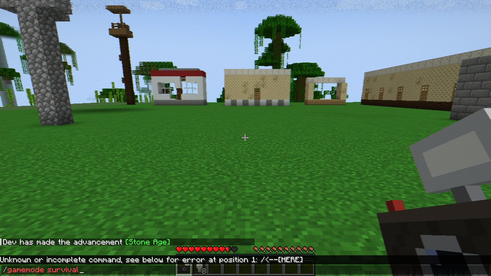 |
| *Creative mode. It has your chat box: "come back down".* | *Its places, out where nobody built them.* |
| 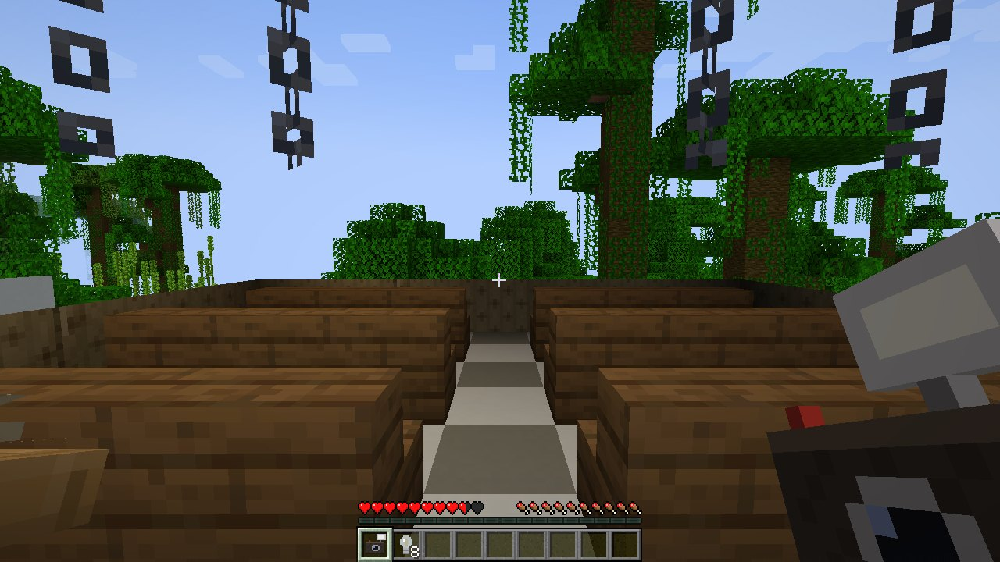 | 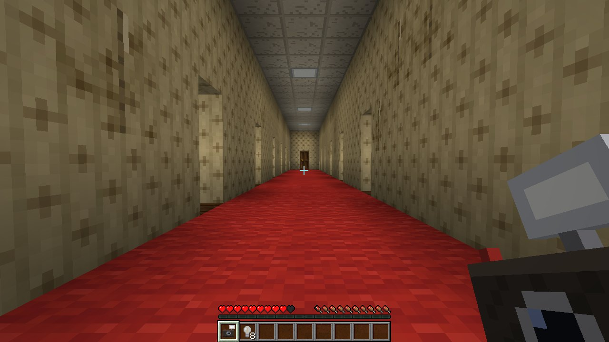 |
| *Please wait.* | *The hallway, standing on its own.* |
| 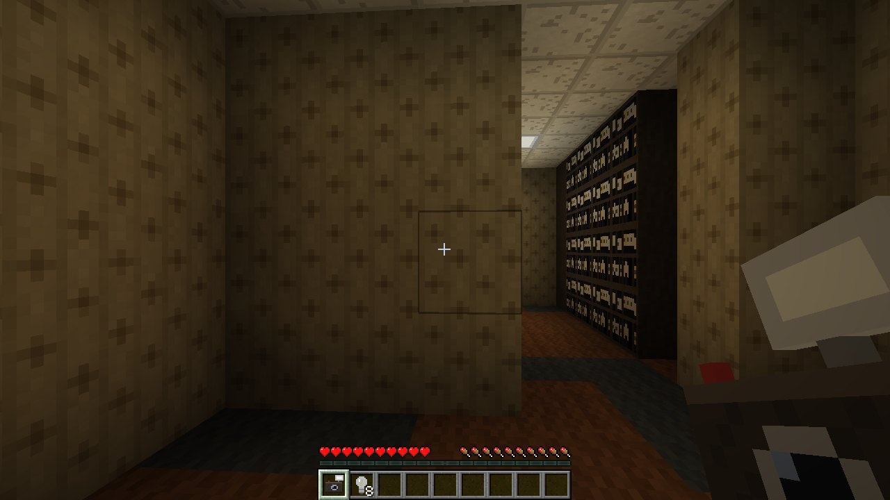 | |
| *The Archive, behind the door at the end of it.* | |

</details>

<details>
<summary><b>How it works (spoilers)</b></summary>

When you sleep, Minecraft deletes the night. When you pause, the world stops. When you open a
chest, you stop looking. **The Wake is whatever uses that time.** It is a black puppet of a thing
with an index card for a face and real eyes behind it, and it never moves while you watch the
world: only while you are in a menu, asleep, or away from the keyboard. Every step it takes is a
frame of stop-motion: behind your inventory you can watch it come, a few drawings a second.

- **Act I.** Small chores happen overnight, but only after nights in a familiar bed. You wake up
  hungrier.
- **Act II.** After lost time, sometimes, far away: four times its size, over the trees, facing
  your house. A ledger appears on your bed, written in your name.
- **Act III.** It comes closer while you are in menus near home, out of the dark, but keeps its
  distance. At the edge of your view it is wearing a different face; look straight at it and it
  is back to the first one, almost. Doors cost it time, and you hear the latch. The pause menu is
  a paused tape. The mornings become a film shot one frame a night: in each room it is a step
  nearer your pillow for every night you slept there.
- **Act IV.** It comes all the way, and stops at arm's length. If you stay in the menu, or open
  one with it already that close, it bites.
- **Act V.** One silent day, then one thing that breaks the rules.
- **The Stopped.** The finale. The world freezes like a paused tape, every place you ever walked
  is burned into it as static, and for once it moves while you watch.

Counterplay, and what it costs:

- **Keep the night.** Staying awake through a whole night pushes it back, and its film back a
  frame. It also makes it angry.
- **Sleep somewhere new.** A new bed slows it down and starts a new film.
- **Light.** It only ever comes out of the dark, and a torch at its feet makes it not be there.
  Furious, it puts your lights out.
- **Walk into it** and it goes away, for an hour of your time. Then two, then three.

**Its temper.** Hurting it, staying up, hiding from it in ways it has to tear down, and cheating
(creative, commands) make it angry. Sleeping and getting caught calm it. It wears its temper on the
card: creased, with a red crayon smile drawn on it too wide; bleeding from the eyes, the smile
scribbled out; torn, with somebody else's card stapled over a corner.

**Its body.** Most of the time it only wants you to know it is there: knocking on the outside of
your walls, breathing on the other side of the one you are facing, footsteps that stop a moment
after yours, your own footsteps from yesterday, a door in your house opening by itself.

When it is angry, you are afraid, and it is dark, it comes for you.

- It runs, a little slower than you can sprint, for half a minute or so. Get out of its sight
  and hide, or outlast it.
- It climbs any wall, digs through what you put in its way, and tears iron doors out of the frame
  and throws them.
- It comes across the water at you, and under it.
- It climbs the back of the tower you built to watch for it.
- It learns how you got away last time.
- If it has hold of you, struggle.

**Its places.** Some mornings there is a map on your bed with a red cross on it:

- a lookout with a camera at the top;
- a video shop's front, closed, by itself;
- a waiting room where every chair has a string hanging over it;
- a bedroom with three walls in the woods;
- a hallway of doors, standing on its own, with one more at the end.

That door opens onto the Archive: the back room of a video shop that does not end, every shelf full
of tapes, one of them with your name on it. Lying down in the bed in the woods puts you on the Set:
your own house rebuilt out of plywood on a dark soundstage, with a camera pointed at your bed, and
it asleep in it.

**Removing it.** Its face is a card held on by four pins:

1. Play your tape at night.
2. Blind it with the camera's flash and pull a pin while it cannot see. Do this four times.
3. With the last pin out, it does only what it always did, and moves only while you are not
   watching. It makes you look away: your inventory, your chat and your pause menu open by
   themselves.
4. Walk back to the machine with your eyes on it, and press eject.

There are three endings.

The full reasoning, including the redesign that turned it into this, is in
[`docs/DESIGN.md`](docs/DESIGN.md).

</details>

## License

MIT. See [LICENSE](LICENSE).
