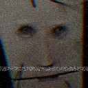
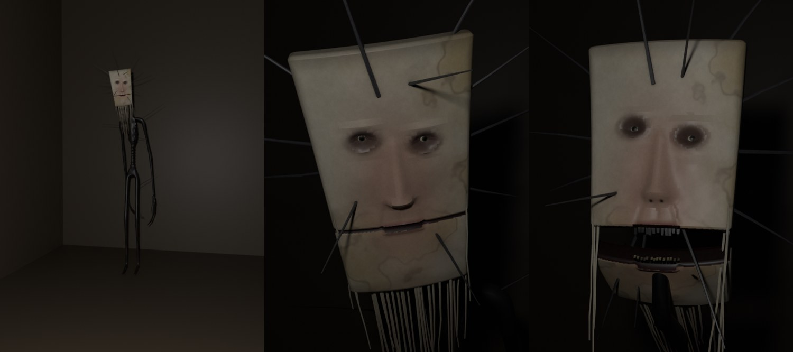
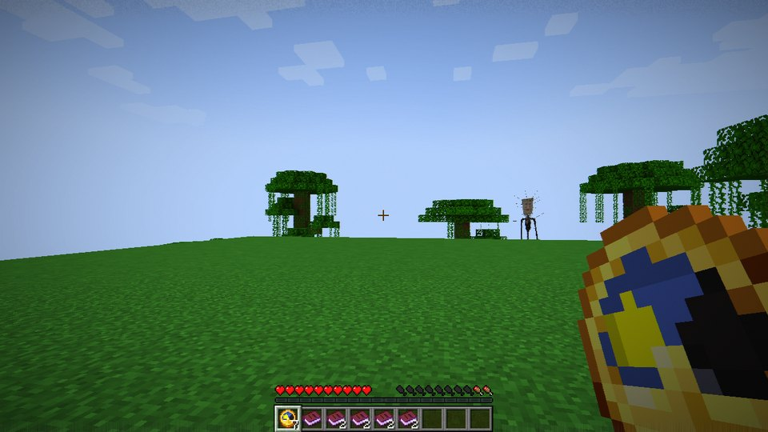
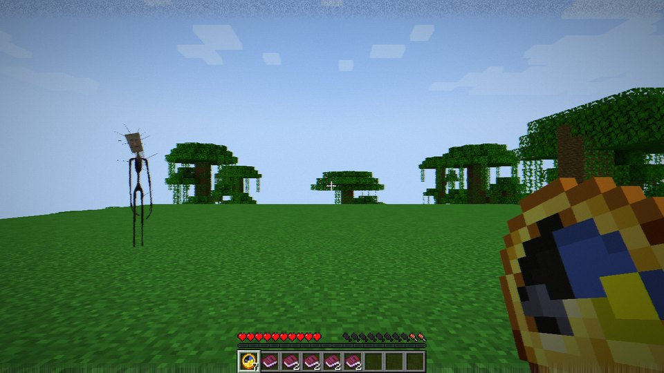
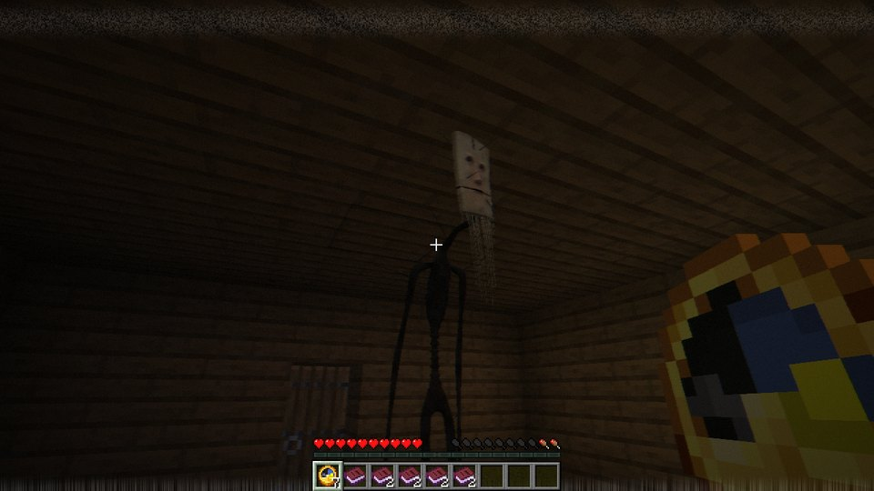
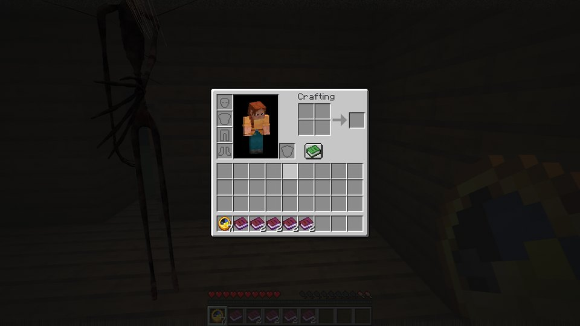
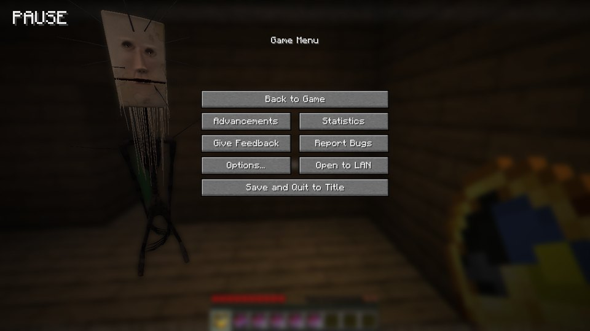
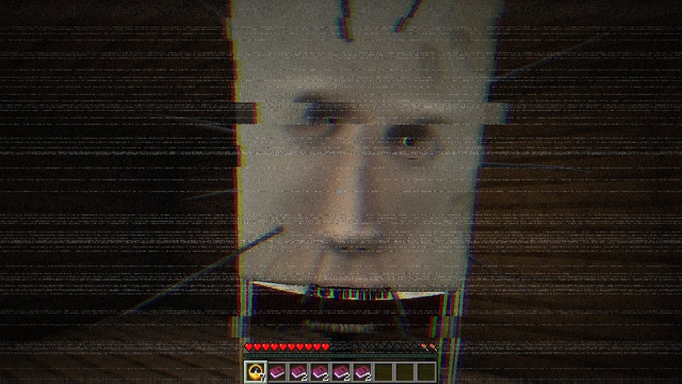

<p align="center"></p>

# The Wake

> *A world folder was sent to us with one note: "I never wrote this."*

**The Wake** is a slow horror mod for **Minecraft Java 1.21.1**, for **NeoForge** and **Fabric**.
It adds no mobs, blocks or items. It works through things you already do without thinking about
them: sleeping, pausing, opening your inventory.

Something in your world only moves while you are not watching it.

---

## Install

| | NeoForge | Fabric |
|---|---|---|
| Minecraft | 1.21.1 | 1.21.1 |
| Loader | NeoForge 21.1.265 or newer | Fabric Loader 0.16.14 or newer + **Fabric API** |
| Java | 21 | 21 |

Drop the jar for your loader into `mods/`. The haunting needs it **on both the client and the
server**. A client with the mod can still join servers without it (nothing happens there), and
the other way round.

How to play it: start (or keep playing) an ordinary survival world and live in it the way you
normally would. It takes a few in-game days to begin. Singleplayer is the intended experience.
Headphones help.

## Content notes

- **One jump scare**, from the fourth act on: a face filling the screen, a picture tear and a
  short distorted scream, at most once per in-game day. The scream has its own volume setting
  (`screamVolume`), and the tape tear can be turned off with everything else visual
  (`tapeEffect`).
- A tall, flat-black, emaciated figure whose head is a stained card with a real human face
  pressed into it, pins driven through it. No gore.
- The picture is made to look like worn videotape at times: grain, scanlines, rolling tracking
  noise. No strobing.
- It can damage you (default six hearts, through armour). In hardcore it leaves you at half a
  heart instead of killing you.
- It can move you, change the time of day in singleplayer, make you hungrier, stop you sleeping,
  and open a door. It never breaks blocks or takes items. Optional world edits (`worldEdits`):
  a placed torch, ripened crops, closed doors, furnace output moved into your chest.
- Everything "meta" stays inside the game: no files outside the game folder, no fake crashes, no
  window-title tricks. It notices real lag spikes but never fakes one.

## Config

`config/thewake.json` is created on first launch. Every option is explained inside the file.

| Option | Default | What it does |
|---|---|---|
| `pace` | `1.0` | Speed of the whole arc. `2.0` is twice as fast. |
| `quietNights` | `1` | Nights you can sleep through before anything happens. |
| `menuHunts` | `true` | It moves while you are in a menu (inventory, chests, crafting, chat). |
| `pauseEvents` | `true` | The pause menu counts too, while the game window has focus. Alt-tabbing never does. |
| `afkEvents`, `afkSeconds` | `true`, `150` | Standing idle is a lapse. |
| `hitchEvents` | `true` | Real frame stalls over one second count (capped per day). |
| `attacks` | `true` | From Act IV it attacks if it reaches you while you are not watching. |
| `attackDamage` | `12.0` | In half-hearts. Armour does not help. |
| `attackHardcoreKills` | `false` | Hardcore: off leaves you at half a heart. |
| `blinkEvents` | `true` | Late game: short blackouts in daylight. Never in hardcore. |
| `stolenMornings` | `true` | Late game: sometimes you do not wake where you went to sleep. Never in hardcore. |
| `worldEdits` | `true` | The small Act I chores near your bed, and the door it leaves open. |
| `finale` | `true` | The finale. |
| `finaleOnServers` | `false` | Allow the finale on multiplayer servers (see below). |
| `tapeEffect` | `true` | Client: the VHS look. |
| `nightSkyShader` | `true` | Client: the finale's ground shader. Turned off automatically while an Iris/Oculus shader pack is active. |
| `soundVolume` | `1.0` | Client: volume of this mod's own sounds. |
| `screamVolume` | `0.8` | Client: volume of the one loud sound. |
| `dimensions` | `["minecraft:overworld"]` | Where it can reach you. |

## Commands

All need permission level 2 (cheats on in singleplayer):

- `/thewake status [player]`: how far along a player is.
- `/thewake stage <player> <stage>`: jump to an act (`night_shift`, `watching`, `sightings`,
  `routine`, `hunt`, `hush`, `stopped`).
- `/thewake beat <player> <beat>`: play one beat right now (`sighting`, `giant`, `morning`,
  `hunt`, `attack`, `headturn`, `ledger`, `stopped`, …). Meant for testing; it spoils things.
- `/thewake reset <player>`

## Multiplayer

Each player has their own haunting, and nobody else can see it: it is not an entity. On a server
the pause menu does not stop the world, so it counts like any other menu. The finale is off by
default on servers, because it freezes the world for one player while the server keeps running
for everyone else; turn on `finaleOnServers` to allow it.

## Compatibility

- **Shader packs (Iris/Oculus):** the creature is drawn with vanilla's entity shader, so packs
  treat it like any entity. The finale's ground switches to a texture while a pack is active.
- **Sleep mods** that speed nights up instead of skipping them still count.
- **Other horror mods** work alongside it. It adds no entities, so it does not collide with
  their spawns.

## Building from source

```bash
./gradlew build
```

The jars end up in `fabric/build/libs/` and `neoforge/build/libs/`. Run a test client with
`./gradlew :fabric:runClient` or `./gradlew :neoforge:runClient`.

A scripted visual demo stages every beat in order and saves screenshots to
`<loader>/runs/client/screenshots`. It needs a singleplayer world called `demo` in that run
folder:

```bash
./gradlew :fabric:runClient -PwakeDemo
```

The creature is built procedurally in headless Blender, with no GUI and no MCP server: Blender
as a Python module.

```bash
pip install bpy==5.2.3 numpy pillow
```

```bash
python tools/creature/build_creature.py --previews
```

That writes the mesh (`models/creature/creature.bin.gz`), its two textures and Cycles preview
renders of every pose. The sounds and small textures are synthesized by
`tools/generate_assets.py` (numpy, Pillow, ffmpeg with libvorbis).

<details>
<summary><b>Screenshots (spoilers)</b></summary>



*The model, rendered in Blender by `tools/creature/build_creature.py`.*

Captured in game by the scripted demo:

| | |
|---|---|
|  |  |
| *Act II: far off, four times its size, facing your way.* | *At the edge of your view. Look straight at it and it is still.* |
|  |  |
| *Mornings: at the foot of the bed. In the dark you only see the card.* | *While you sort your inventory.* |
|  |  |
| *The pause menu is a paused tape. It is still moving.* | *What happens when it reaches you.* |

</details>

<details>
<summary><b>How it works (spoilers)</b></summary>

When you sleep, Minecraft deletes the night. When you pause, the world stops. When you open a
chest, you stop looking. **The Wake is whatever uses that time.** It is a tall black thing with a
card for a head and a face on the card, and it never moves while you watch the world: only while
you are in a menu, asleep, or away from the keyboard. Every step it takes is a cut, like
stop-motion.

- **Act I.** Small chores happen overnight, but only after nights in a familiar bed. You wake up
  hungrier.
- **Act II.** After lost time, sometimes, far away: four times its size, on the horizon or above
  the trees, facing your house. A ledger appears on your bed, written in your name.
- **Act III.** It comes closer while you are in menus, but keeps its distance. At the edge of
  your view its head jerks; look straight at it and it is still; look away and back and it is
  facing you. In the morning it is in your doorway. The pause menu is a paused tape.
- **Routine.** It comes all the way. Mornings, it is at the foot of your bed.
- **Act IV.** If it reaches you while you are not watching, it attacks. Once a day.
- **Act V.** Silence, then one thing that breaks the rules.
- **The Stopped.** The finale. The world freezes like a paused tape, every place you ever walked
  is burned into it as static, and for once it moves while you watch.

Counterplay: staying awake through a whole night pushes it back, sleeping somewhere new slows it
down, and walking into it makes it go away, for a price. There are two endings.

The full reasoning, including the redesign that turned it into this, is in
[`docs/DESIGN.md`](docs/DESIGN.md).

</details>

## License

MIT. See [LICENSE](LICENSE).
